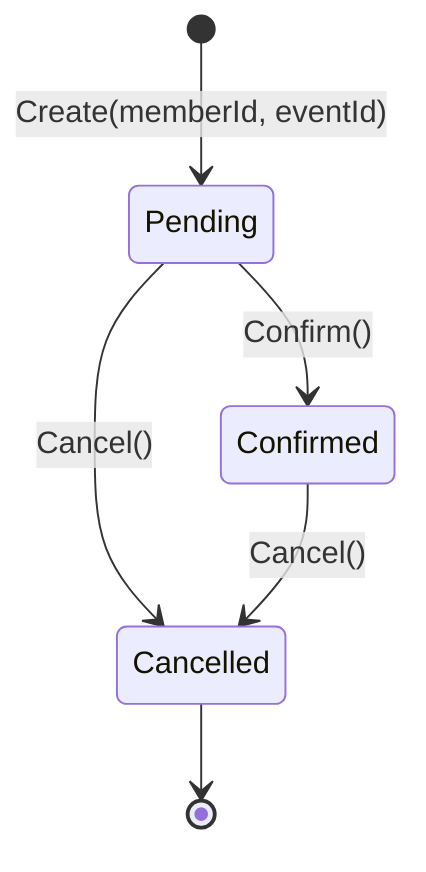
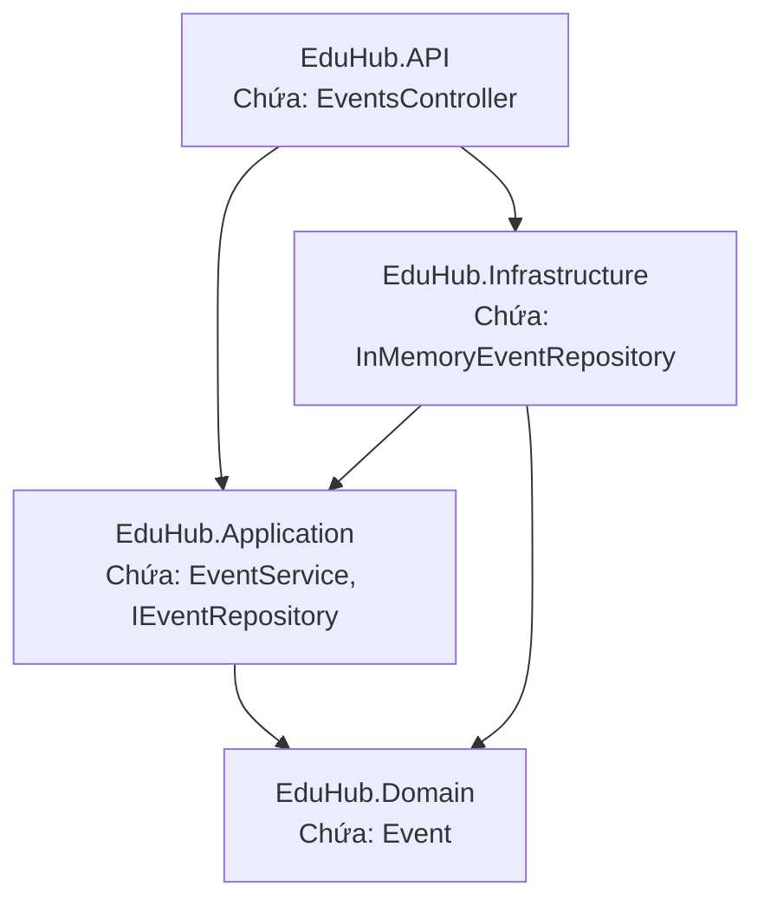

# BÀI LÀM KIỂM TRA GIỮA HỌC PHẦN - IN4211

## Câu 1a
Bốn trụ cột của lập trình hướng đối tượng (OOP):
1. **Đóng gói (Encapsulation):** Che giấu dữ liệu/trạng thái nội tại của đối tượng, không cho phép bên ngoài sửa trực tiếp mà phải thông qua các phương thức kiểm soát hợp lệ.
   - *Minh hoạ:* Tệp `EduHub.Domain/Entities/Member.cs` (lớp `Member`) và `EduHub.Domain/Entities/Registration.cs` (lớp `Registration`) dùng `private set` cho các thuộc tính và `private constructor`.
2. **Trừu tượng hoá (Abstraction):** Ẩn đi các chi tiết cài đặt phức tạp bên trong, chỉ phơi bày các giao diện (hợp đồng hành vi) cần thiết ra bên ngoài.
   - *Minh hoạ:* Tệp `EduHub.Application/Interfaces/IEventRepository.cs` (interface `IEventRepository`) và `EduHub.Application/Interfaces/INotificationService.cs` (interface `INotificationService`).
3. **Kế thừa (Inheritance):** Cho phép lớp con tái sử dụng các thuộc tính và phương thức đã định nghĩa ở lớp cha.
   - *Minh hoạ:* Tệp `EduHub.Domain/Entities/Member.cs` (lớp `Member` kế thừa từ lớp `BaseEntity` trong tệp `EduHub.Domain/Entities/BaseEntity.cs`).
4. **Đa hình (Polymorphism):** Cho phép các đối tượng thuộc các lớp khác nhau thực thi cùng một phương thức theo các cách riêng biệt thông qua một giao diện chung.
   - *Minh hoạ:* Tệp `EduHub.Infrastructure/Notifications/NotificationServices.cs` (hai lớp `EmailNotificationService` và `SmsNotificationService` cùng thực thi phương thức `Send` của `INotificationService`).

## Câu 1b
Hai vấn đề về đóng gói của lớp `Member` ban đầu:
1. Các thuộc tính `Id` và `Email` để `public set`, khiến bất kỳ lớp nào bên ngoài cũng có thể tự ý gán giá trị sai lệch (như `m.Email = "abc"` không đúng định dạng email) bất cứ lúc nào.
2. Constructor mặc định `public Member() { }` cho phép tạo đối tượng rỗng mà không qua kiểm tra ràng buộc (validation), dẫn đến đối tượng tồn tại ở trạng thái không hợp lệ (`Email` bị `null`).

## Câu 2a

## Câu 3a
Ba nguyên lý SOLID mà lớp `EventService` vi phạm:
1. **Single Responsibility Principle (SRP) - Nguyên lý đơn trách nhiệm:**
   - *Dòng vi phạm:* Dòng 5–6 (kiểm tra tính hợp lệ dữ liệu), dòng 8–9 (kết nối và lưu CSDL SQL), dòng 10 (ghi log ra tệp), dòng 11–14 (gửi thông báo qua Email/SMS).
   - *Giải thích:* Lớp `EventService` đảm nhận quá nhiều trách nhiệm khác nhau; khi thay đổi cách lưu trữ, cách ghi log hoặc kênh thông báo đều phải sửa lớp này.
2. **Open/Closed Principle (OCP) - Nguyên lý đóng/mở:**
   - *Dòng vi phạm:* Dòng 11–14 (`if (channel == "email") ... else if (channel == "sms") ...`).
   - *Giải thích:* Khi muốn bổ sung kênh thông báo mới (như Push Notification, Zalo), ta buộc phải sửa đổi trực tiếp mã nguồn của hàm `CreateEvent` thay vì chỉ mở rộng.
3. **Dependency Inversion Principle (DIP) - Nguyên lý đảo ngược phụ thuộc:**
   - *Dòng vi phạm:* Dòng 8 (`new SqlConnection(...)`), dòng 10 (`File.AppendAllText(...)`), dòng 12 (`new EmailSender()`), dòng 14 (`new SmsSender()`).
   - *Giải thích:* Lớp xử lý nghiệp vụ cấp cao (`EventService`) phụ thuộc trực tiếp vào các lớp cài đặt chi tiết cấp thấp thông qua từ khoá `new` thay vì phụ thuộc vào các giao diện trừu tượng (interface).

## Câu 3a
Ba nguyên lý SOLID mà lớp `EventService` vi phạm:
1. **Single Responsibility Principle (SRP) - Nguyên lý đơn trách nhiệm:**
   - *Dòng vi phạm:* Dòng 5–6 (kiểm tra tính hợp lệ dữ liệu), dòng 8–9 (kết nối và lưu CSDL SQL), dòng 10 (ghi log ra tệp), dòng 11–14 (gửi thông báo qua Email/SMS).
   - *Giải thích:* Lớp `EventService` đảm nhận quá nhiều trách nhiệm khác nhau; khi thay đổi cách lưu trữ, cách ghi log hoặc kênh thông báo đều phải sửa lớp này.
2. **Open/Closed Principle (OCP) - Nguyên lý đóng/mở:**
   - *Dòng vi phạm:* Dòng 11–14 (`if (channel == "email") ... else if (channel == "sms") ...`).
   - *Giải thích:* Khi muốn bổ sung kênh thông báo mới (như Push Notification, Zalo), ta buộc phải sửa đổi trực tiếp mã nguồn của hàm `CreateEvent` thay vì chỉ mở rộng.
3. **Dependency Inversion Principle (DIP) - Nguyên lý đảo ngược phụ thuộc:**
   - *Dòng vi phạm:* Dòng 8 (`new SqlConnection(...)`), dòng 10 (`File.AppendAllText(...)`), dòng 12 (`new EmailSender()`), dòng 14 (`new SmsSender()`).
   - *Giải thích:* Lớp xử lý nghiệp vụ cấp cao (`EventService`) phụ thuộc trực tiếp vào các lớp cài đặt chi tiết cấp thấp thông qua từ khoá `new` thay vì phụ thuộc vào các giao diện trừu tượng (interface).

## Câu 4b
- **Phân biệt git merge và git rebase:**
  - git merge: Kết hợp lịch sử của hai nhánh bằng cách tạo ra một *merge commit* mới, giữ nguyên toàn bộ lịch sử phân nhánh thực tế theo đúng trình tự thời gian.
  - git rebase: Di chuyển gốc của nhánh hiện tại lên đầu nhánh đích bằng cách viết lại các commit để tạo thành một lịch sử commit thẳng (linear history), không sinh ra merge commit.
- **Khi nào KHÔNG nên dùng 
ebase:**
  - Không dùng git rebase trên các nhánh công khai / nhánh dùng chung (như main, develop) đã được đẩy lên kho chung và có người khác cùng làm việc, vì 
ebase viết lại lịch sử commit (thay đổi mã SHA), gây xung đột và làm lệch lịch sử với kho của thành viên khác.

## Câu 5a

- **EduHub.Domain**: Chứa Event
- **EduHub.Application**: Chứa IEventRepository, EventService
- **EduHub.Infrastructure**: Chứa InMemoryEventRepository
- **EduHub.API**: Chứa EventsController

## Câu 5b
Project EduHub.Domain không được tham chiếu tới EduHub.Infrastructure vì:
- Theo quy tắc phụ thuộc (Dependency Rule) của Clean Architecture, chiều phụ thuộc phải hướng vào trong. Domain là tầng lõi chứa các quy tắc nghiệp vụ cốt lõi nên không được phụ thuộc vào bất kỳ tầng nào khác.
- Nếu Domain tham chiếu tới Infrastructure (chứa CSDL, hệ thống file, dịch vụ gửi mail/SMS...), logic nghiệp vụ sẽ bị phụ thuộc chặt vào công nghệ lưu trữ cụ thể, làm mất khả năng tái sử dụng và kiểm thử độc lập.

## Câu 5d
- **Nguyên nhân:** Dịch vụ đăng ký bằng AddScoped sẽ tạo ra một đối tượng (instance) mới cho mỗi HTTP Request. Vì List<Event> trong InMemoryEventRepository không phải là static, nên khi gọi request POST, sự kiện được lưu vào List<Event> của instance thứ nhất và bị huỷ ngay khi request POST kết thúc. Khi gọi request GET sau đó, một instance InMemoryEventRepository mới hoàn toàn được tạo ra với List<Event> rỗng.
- **Cách đăng ký để tránh lỗi:** Đăng ký InMemoryEventRepository với vòng đời **Singleton** trong Program.cs:
  uilder.Services.AddSingleton<IEventRepository, InMemoryEventRepository>();
  để dùng chung duy nhất một instance trong suốt thời gian chạy ứng dụng.
