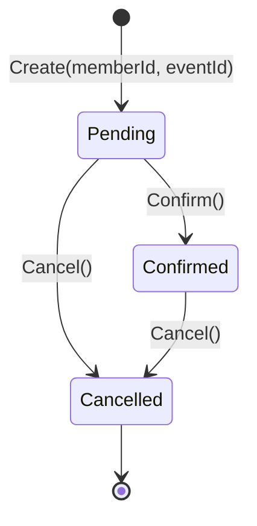

# BÀI LÀM KIỂM TRA GIỮA HỌC PHẦN - IN4211

## Câu 1a
Bốn trụ cột của lập trình hướng đối tượng (OOP):
1. **Đóng gói (Encapsulation):** Che giấu dữ liệu/trạng thái nội tại của đối tượng, không cho phép bên ngoài sửa trực tiếp mà phải thông qua các phương thức kiểm soát hợp lệ.
   - *Minh hoạ:* Tệp `EduHub.Domain/Entities/Member.cs` (lớp `Member`) và `EduHub.Domain/Entities/Registration.cs` (lớp `Registration`) dùng `private set` cho các thuộc tính và `private constructor`.
2. **Trừu tượng hoá (Abstraction):** Ẩn đi các chi tiết cài đặt phức tạp bên trong, chỉ phơi bày các giao diện (hợp đồng hành vi) cần thiết ra bên ngoài.
   - *Minh hoạ:* Tệp `EduHub.Application/Interfaces/IEventRepository.cs` (interface `IEventRepository`) và `EduHub.Application/Interfaces/INotificationService.cs` (interface `INotificationService`).
3. **Kế thừa (Inheritance):** Cho phép lớp con tái sử dụng các thuộc tính và phương thức đã định nghĩa ở lớp cha.
   - *Minh hoạ:* Tệp `EduHub.Domain/Entities/Member.cs` (lớp `Member` kế thừa từ lớp `BaseEntity` trong tệp `EduHub.Domain/Entities/BaseEntity.cs`).
4. **Đa hình (Polymorphism):** Cho phép các đối tượng thuộc các lớp khác nhau thực thi cùng một phương thức theo các cách riêng biệt thông qua một giao diện chung.
   - *Minh hoạ:* Tệp `EduHub.Infrastructure/Notifications/NotificationServices.cs` (hai lớp `EmailNotificationService` và `SmsNotificationService` cùng thực thi phương thức `Send` của `INotificationService`).

## Câu 1b
Hai vấn đề về đóng gói của lớp `Member` ban đầu:
1. Các thuộc tính `Id` và `Email` để `public set`, khiến bất kỳ lớp nào bên ngoài cũng có thể tự ý gán giá trị sai lệch (như `m.Email = "abc"` không đúng định dạng email) bất cứ lúc nào.
2. Constructor mặc định `public Member() { }` cho phép tạo đối tượng rỗng mà không qua kiểm tra ràng buộc (validation), dẫn đến đối tượng tồn tại ở trạng thái không hợp lệ (`Email` bị `null`).

## Câu 2a

